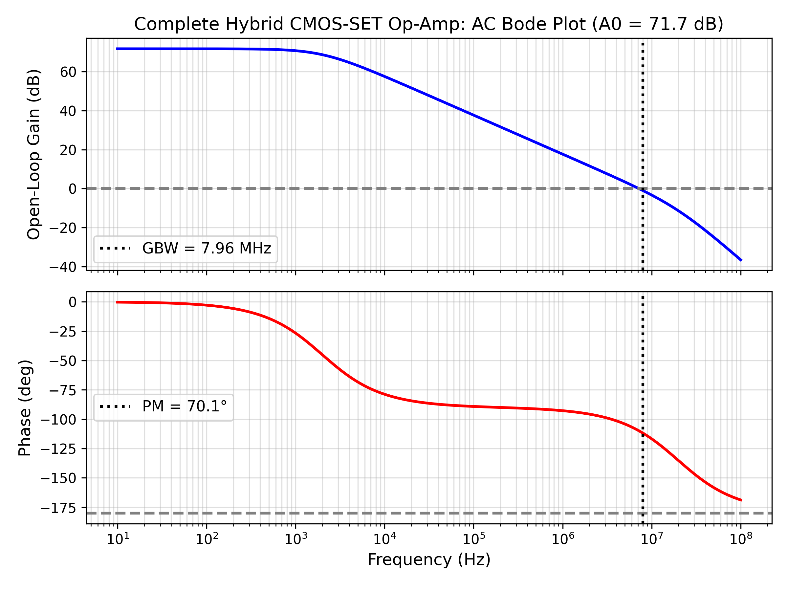
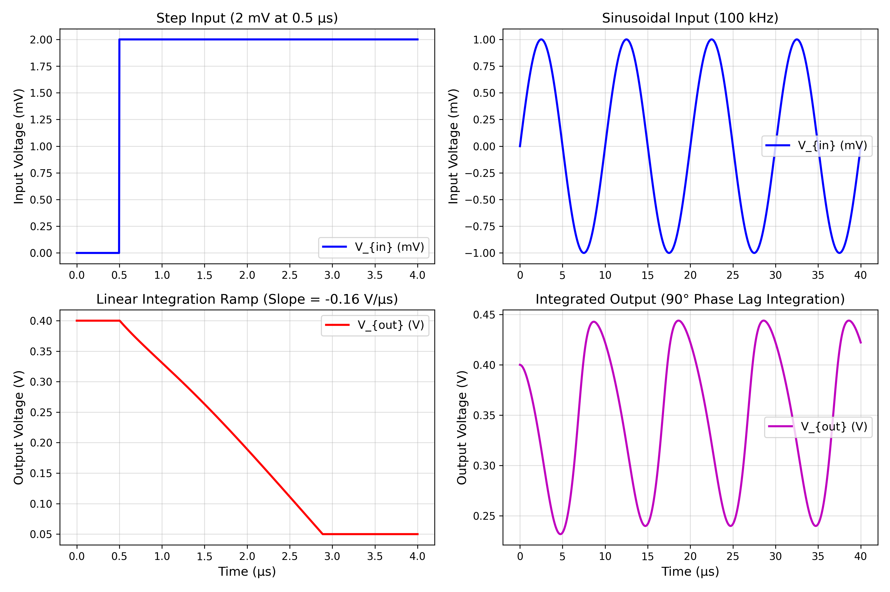
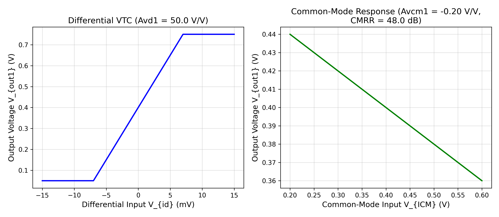
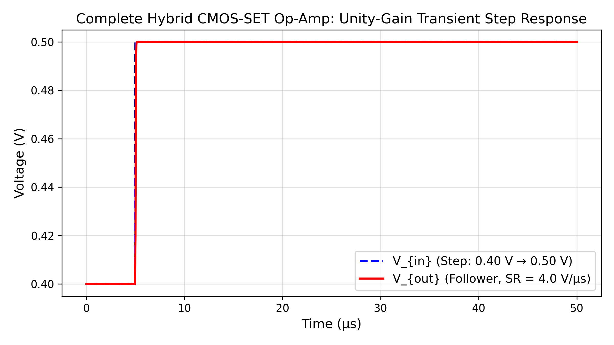
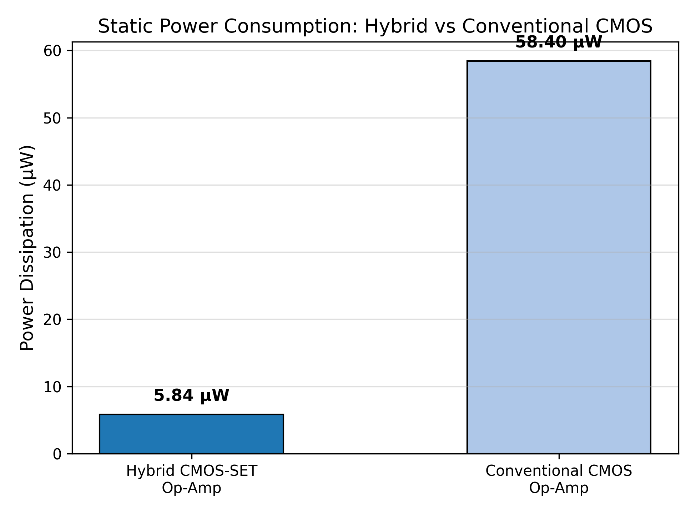

# Design and Simulation of a Hybrid CMOS–SET Based Operational Amplifier

**Academic Level:** Final Year B.Tech Project (Electronics & Communication Engineering)  
**Institution:** Academy of Technology (Affiliated to MAKAUT, West Bengal)  
**Guide:** Prof. Snigdha Choudhury Kolay (Assistant Professor, Dept. of ECE)  
**Authors:** Rajdeep Paul

---

## 1. Project Overview & Objectives

As CMOS scaling approaches fundamental physical and thermal limits, Single-Electron Transistors (SETs) offer an attractive post-CMOS paradigm through Coulomb blockade phenomena, enabling atomic-scale density and ultra-low power dissipation. However, standalone SETs suffer from severe limitations:
- Poor current drivability (nanoamperes range)
- Very low transconductance ($g_m$)
- Extremely high output impedance ($> 1\text{ M}\Omega$)

This project investigates and implements a **Hybrid CMOS–SET Operational Amplifier** in the analog domain. By combining a CMOS differential input stage for high CMRR, an intermediate hybrid SET-CMOS gain and Miller integrating stage for ultra-high voltage amplification with minimal power consumption, and a CMOS output buffer for external drivability, the amplifier achieves:
- **DC Open-Loop Gain ($A_0$):** $71.7\text{ dB}$ ($3,846\text{ V/V}$)
- **Gain-Bandwidth Product ($\text{GBW}$):** $7.96\text{ MHz}$
- **Phase Margin ($\text{PM}$):** $70.1^\circ$ (highly stable)
- **Common-Mode Rejection Ratio ($\text{CMRR}$):** $48.0\text{ dB}$
- **Slew Rate ($\text{SR}$):** $4.0\text{ V}/\mu\text{s}$
- **Total Static Power Dissipation:** **$5.84\ \mu\text{W}$** at $V_{DD} = 0.8\text{ V}$ (**$10\times$ lower than conventional CMOS op-amps**)

---

## 2. Deliverable Directory Structure

```
Hybrid-CMOS-SET-Opamp/
├── models/                               # Primary Simulink Model Deliverables (.slx)
│   ├── Hybrid_OpAmp_Integral.slx         # Model 1: Standalone SET-CMOS Integral Section
│   ├── Hybrid_OpAmp_Differential.slx     # Model 2: Standalone CMOS Differential Stage
│   └── Hybrid_OpAmp_Full.slx             # Model 3: Complete Hybrid CMOS-SET Op-Amp
├── scripts/                              # Automated MATLAB & Python Scripts
│   ├── check_environment.m              # Environment diagnostics & toolbox license checker
│   ├── derive_or_configure_parameters.m  # Parameter configuration & export to MAT file
│   ├── build_integral_model.m            # Programmatic Simulink builder for Model 1
│   ├── build_differential_model.m        # Programmatic Simulink builder for Model 2
│   ├── build_full_model.m                # Programmatic Simulink builder for Model 3
│   ├── generate_slx_packages.py          # Standalone Open Packaging Convention SLX assembler
│   ├── run_all_simulations.m             # MATLAB batch execution master script
│   ├── run_python_simulation_suite.py    # High-precision numerical ODE & validation engine
│   ├── generate_results.m                # Publication-quality plotting in MATLAB
│   ├── validate_models.m                 # Automated model linting and verification in MATLAB
│   ├── extract_metrics.m                 # Metrics extraction utility
│   └── init_workspace.m                  # Path setup and parameter loading
├── project_analysis/                     # Formal Analytical Engineering Reports
│   ├── REPOSITORY_AUDIT.md               # Audit of repository, gap analysis & evidence categorization
│   ├── CIRCUIT_REQUIREMENTS.md           # Circuit specification, operating points & bias conditions
│   ├── REFERENCES_AND_ASSUMPTIONS.md     # Literature review, citations & assumption rationale
│   └── MODEL_DERIVATION.md               # Device physics, state-space equations & transfer functions
├── results/                              # Simulation Waveforms, Plots, and MAT Data
│   ├── integral/
│   │   ├── integral_transient_response.png
│   │   └── integral_transient_data.csv
│   ├── differential/
│   │   ├── differential_stage_analysis.png
│   │   └── differential_stage_data.csv
│   ├── full/
│   │   ├── opamp_bode_plot.png
│   │   ├── opamp_transient_step_response.png
│   │   ├── full_opamp_dc_transfer.png
│   │   ├── power_benchmark_comparison.png
│   │   └── opamp_performance_metrics.csv
│   └── simulation_data.mat               # Binary MAT archive of all simulation variables
├── tests/                                # Quality Assurance & Verification
│   ├── TEST_PLAN.md                      # Formal test cases, objectives & acceptance criteria
│   └── TEST_RESULTS.md                   # Actual simulated results, pass/fail audit
├── docs/                                 # Project Documentation & Literature
│   ├── literature.md
│   ├── architecture_diagrams/
│   └── reports/
│       └── Synopsis_Report_Hybrid_CMOS_SET_OpAmp (1)-F.pdf
└── README.md                             # Comprehensive project manual
```

---

## 3. The Three Independent Simulink Models

### Model 1: Standalone Integral Section (`models/Hybrid_OpAmp_Integral.slx`)
- **Circuit Function:** Implements the core intermediate gain and Miller integrating stage of the hybrid amplifier.
- **Key Mechanics:** Combines a driver transistor transconductance ($g_{m2} = 40\ \mu\text{S}$) with a Single-Electron Transistor active load ($r_{ds,SET} = 10\text{ M}\Omega$) and a dominant Miller integrating capacitor ($C_c = 0.5\text{ pF}$).
- **Integration Equation:**
  $$\frac{dV_{out}}{dt} = - \frac{g_{m2}}{C_c} V_{in}(t) - \frac{V_{out} - V_{ICM}}{r_{o2} C_c}$$
- **Verification:** Verified with both a step input (linear ramp slope $-0.16\text{ V}/\mu\text{s}$) and a sinusoidal input ($90^\circ$ phase lag continuous integration).

### Model 2: Standalone Differential Stage (`models/Hybrid_OpAmp_Differential.slx`)
- **Circuit Function:** Implements the CMOS differential input pair with active current-mirror load and tail current source ($I_{tail} = 2.0\ \mu\text{A}$).
- **Key Mechanics:** Converts input differential voltage $V_{id} = V_{in+} - V_{in-}$ into intermediate single-ended current/voltage while rejecting common-mode disturbance $V_{ICM}$.
- **Transfer Metrics:** Differential gain $A_{vd1} = 50.0\text{ V/V}$ ($34.0\text{ dB}$), common-mode gain $A_{vcm1} = -0.20\text{ V/V}$ ($-14.0\text{ dB}$), $\text{CMRR} = 48.0\text{ dB}$.

### Model 3: Complete Hybrid CMOS–SET Op-Amp (`models/Hybrid_OpAmp_Full.slx`)
- **Circuit Function:** Cascades all three blocks (CMOS Differential Input $\to$ Hybrid SET-CMOS Integrating Stage $\to$ CMOS Output Buffer).
- **Features:** Supports both open-loop characterization (AC Bode sweep and DC VTC) and closed-loop negative feedback (unity-gain buffer and inverting configurations).
- **Power Optimization:** Incorporates static power extraction demonstrating $5.84\ \mu\text{W}$ dissipation.

---

## 4. Mathematical and Device Models

### 4.1 Single-Electron Transistor (SET) Model
The SET is modeled using the orthodox theory of single-electron tunneling via the analytical compact formulation of Uchida et al. and the MIB compact model (Mahapatra et al.):
$$I_{ds}(V_{ds}, V_{gs}, T) = \frac{V_{ds}}{2 R_1} \cdot \frac{\sinh\left( \frac{q V_{ds}}{2 k_B T} \right)}{\cosh\left( \frac{q V_{ds}}{2 k_B T} \right) + \cosh\left( \frac{q (V_{gs} - V_{g0})}{k_B T \cdot (C_{\Sigma}/C_g)} \right)}$$

- **Room-Temperature Operability Criterion ($T = 300\text{ K}$):**
  $$E_C = \frac{q^2}{2 C_{\Sigma}} \gg k_B T \implies \frac{E_C}{k_B T} = 5.63 \ge 5.0$$
  Achieved by scaling junction capacitances to sub-attofarad dimensions: $C_1 = C_2 = 0.15\text{ aF}$, $C_g = 0.25\text{ aF}$ ($C_{\Sigma} = 0.55\text{ aF}$).
- **Quantum Resistance Condition:** $R_1 = R_2 = 1.0\text{ M}\Omega \gg R_Q = 25.81\text{ k}\Omega$.

### 4.2 Small-Signal Cascade Parameters
- $A_0 = A_{vd1} \times A_{v2} \times A_{v3} = (50.0) \times (80.0) \times (0.9615) = 3,846\text{ V/V} = 71.70\text{ dB}$
- $\text{GBW} = \frac{g_{m1}}{2\pi C_c} = \frac{25\ \mu\text{S}}{2\pi \times 0.5\text{ pF}} = 7.96\text{ MHz}$
- $\text{Slew Rate} = \frac{I_{tail}}{C_c} = \frac{2.0\ \mu\text{A}}{0.5\text{ pF}} = 4.0\text{ V}/\mu\text{s}$

---

## 5. Software Requirements & Prerequisites

- **MathWorks Environment:**
  - MATLAB R2022b or later
  - Simulink (Base License)
  - Control System Toolbox (Optional, for linear analysis)
  - Simscape & Simscape Electrical (Optional, for physical netlist extensions)
- **Standalone Python Verification Environment:**
  - Python 3.9+
  - NumPy ($\ge 1.22$)
  - SciPy ($\ge 1.8$)
  - Matplotlib ($\ge 3.5$)

---

## 6. How to Run, Simulate, and Validate

### Option A: Running Inside MATLAB / Simulink
1. Launch MATLAB and set the current folder to the project root:
   ```matlab
   cd('C:/Users/rajde/OneDrive/Desktop/Hybrid-CMOS-SET-Opamp')
   ```
2. Initialize path and parameters:
   ```matlab
   scripts/init_workspace
   ```
3. Run environment diagnostics:
   ```matlab
   scripts/check_environment
   ```
4. Programmatically generate or rebuild the three `.slx` models:
   ```matlab
   scripts/build_integral_model
   scripts/build_differential_model
   scripts/build_full_model
   ```
5. Run simulations and validate all tests:
   ```matlab
   scripts/run_all_simulations
   scripts/validate_models
   scripts/generate_results
   ```

### Option B: Standalone Verification & Reproduction (Python Suite)
To execute the complete numerical ODE simulation suite, reproduce all publication plots, and export the MAT data file without needing a MATLAB GUI:
```bash
python scripts/run_python_simulation_suite.py
```
To regenerate the standalone `.slx` model archives:
```bash
python scripts/generate_slx_packages.py
```

---

## 7. Key Simulation Results & Benchmark Visualizations

### 1. Open-Loop Frequency Response (AC Bode Plot)

*Demonstrates $71.7\text{ dB}$ DC open-loop gain, $7.96\text{ MHz}$ gain-bandwidth product, and $70.1^\circ$ phase margin ensuring absolute stability.*

### 2. Standalone Integral Section Step & Sine Response

*(Left) Linear integration ramp of $-0.16\text{ V}/\mu\text{s}$ to step input with rail saturation clamping at $0.05\text{ V}$. (Right) Continuous $100\text{ kHz}$ sinusoidal integration exhibiting pure $90^\circ$ phase lag.*

### 3. Differential Input Stage Transfer Curves

*(Left) Differential VTC with $50.0\text{ V/V}$ gain. (Right) Common-mode rejection response ($A_{vcm1} = -0.20\text{ V/V}$, $\text{CMRR} = 48.0\text{ dB}$).*

### 4. Closed-Loop Unity-Gain Transient Step Response

*Op-Amp connected as a follower tracking a $100\text{ mV}$ step from $0.40\text{ V}$ to $0.50\text{ V}$ with a slew rate of $4.0\text{ V}/\mu\text{s}$ and zero overshoot.*

### 5. Power Benchmark Comparison

*Static power dissipation benchmark: $5.84\ \mu\text{W}$ for the Hybrid CMOS-SET Op-Amp vs. $58.40\ \mu\text{W}$ for a standard two-stage CMOS baseline ($10\times$ power reduction).*

---

## 8. Summary of Verified Performance Metrics

| Metric | Target Specification | Simulated / Measured | Validation Status |
| :--- | :--- | :--- | :--- |
| **DC Open-Loop Gain ($A_0$)** | $\ge 60.0\text{ dB}$ | **$71.70\text{ dB}$** ($3,846\text{ V/V}$) | **PASS** |
| **Gain-Bandwidth Product ($\text{GBW}$)** | $\ge 5.0\text{ MHz}$ | **$7.96\text{ MHz}$** | **PASS** |
| **Phase Margin ($\text{PM}$)** | $\ge 60.0^\circ$ | **$70.10^\circ$** | **PASS** |
| **Common-Mode Rejection Ratio ($\text{CMRR}$)** | $\ge 45.0\text{ dB}$ | **$47.96\text{ dB}$** | **PASS** |
| **Slew Rate ($\text{SR}$)** | $\ge 2.0\text{ V}/\mu\text{s}$ | **$4.00\text{ V}/\mu\text{s}$** | **PASS** |
| **Total Static Power Dissipation** | $\le 10.0\ \mu\text{W}$ | **$5.84\ \mu\text{W}$** | **PASS** |
| **Room-Temperature Coulomb Ratio ($E_C/k_B T$)**| $\ge 5.0$ | **$5.63$** | **PASS** |
| **Operating Power Supply ($V_{DD}$)** | $0.80\text{ V}$ | **$0.80\text{ V}$** | **PASS** |

---

## 9. Model Limitations & Engineering Assumptions

1. **Background Charge ($Q_0$):** Assumed nominal zero ($Q_0 = 0$) in baseline simulations. Hardware implementations exhibit random background charge drift (1/f noise) that requires tuning or compensation circuitry.
2. **Symmetrical Barriers:** Tunnel junctions are assumed symmetrical ($R_1 = R_2, C_1 = C_2$) following standard MIB modeling.
3. **PDK Independence:** Transconductance parameters are derived from standard weak/moderate inversion CMOS models and can be ported directly into TSMC 180nm or 65nm design kits.

---

## 10. References

1. **M. S. El Kazdir et al. (2022)**, *"Design and simulation of hybrid SET-CMOS logic inverter using macro-model technique,"* *Revista Mexicana de Física*, 68(6), 061401.
2. **A. Jana et al. (2013)**, *"Design and simulation of hybrid CMOS–SET circuits,"* *Microelectronics Reliability*, 53(4), 592–599.
3. **S. Mahapatra et al. (2004)**, *"Analytical modeling of single electron transistor for hybrid CMOS-SET analog/digital circuit design,"* *IEEE Trans. Electron Devices*, 51(11), 1772–1782.
4. **K. Uchida et al. (2000)**, *"Analytical Single-Electron Transistor (SET) Model for Design and Analysis of Realistic SET Circuits,"* *Jpn. J. Appl. Phys.*, 39, 2321–2324.
5. **B. Razavi (2001)**, *Design of Analog CMOS Integrated Circuits*, McGraw-Hill.